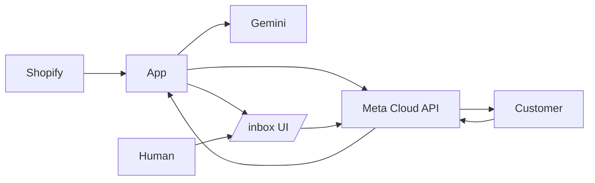

# shopify-wa

A small Node.js service that turns a Shopify store + a Meta WhatsApp Cloud API number into an order-confirmation bot:

1. **Shopify `orders/create`** webhook fires.
2. We send the customer a rich WhatsApp message (image header, order summary, "Confirm" / "I have a question" buttons).
3. **Customer confirms** → we tag the order `wa-confirmed` in Shopify and reply.
4. **Customer asks something** → Google Gemini 2.5 Flash answers from the order context.
5. **Customer asks for a human, or AI is unsure** → conversation is flagged in a built-in `/inbox` web UI (and optionally Slack), AI pauses, you take over.



## Stack

- Node 20+, TypeScript, [Hono](https://hono.dev) HTTP server
- Prisma + SQLite (one file, no DB to run; swap to Postgres by editing `prisma/schema.prisma`)
- Meta WhatsApp Cloud API — direct `fetch`, no SDK
- Shopify Admin GraphQL API for order tagging
- Google Gemini 2.5 Flash (`@google/genai`) for AI replies + function calling
- pino logging, zod env validation

## Quick start

```bash
nvm use 20
cp .env.example .env       # fill in real values, see "Setup walkthrough" below
npm install
npm run db:push            # creates dev.db
npm run dev
```

Then expose `localhost:3000` to the public internet so Shopify and Meta can reach the webhooks:

```bash
# easiest, no account needed:
cloudflared tunnel --url http://localhost:3000
# or:
ngrok http 3000
```

Set `PUBLIC_BASE_URL` in `.env` to that public URL.

The `/inbox` UI is at `${PUBLIC_BASE_URL}/inbox` (basic-auth: `INBOX_USERNAME` / `INBOX_PASSWORD`).

## Setup walkthrough

### 1. Meta WhatsApp Business

1. Go to <https://developers.facebook.com/> → **My Apps** → **Create App** → choose **Business** type.
2. In the app dashboard, **Add Product** → **WhatsApp**.
3. Under **WhatsApp → API Setup**, you'll get:
   - A test phone number (or add your own under **Phone numbers**).
   - The **Phone number ID** → `WHATSAPP_PHONE_NUMBER_ID`.
   - The **WhatsApp Business Account ID** → `WHATSAPP_BUSINESS_ACCOUNT_ID`.
4. Generate a **System User permanent token** (Business Settings → Users → System Users → Generate token) with the `whatsapp_business_messaging` and `whatsapp_business_management` scopes → `WHATSAPP_TOKEN`.
5. Copy your **App Secret** (Settings → Basic → App Secret → "Show") → `WHATSAPP_APP_SECRET`.
6. Choose any random string for `WHATSAPP_VERIFY_TOKEN` (used only during webhook verification).
7. Under **WhatsApp → Configuration → Webhook**:
   - Callback URL: `${PUBLIC_BASE_URL}/webhooks/whatsapp`
   - Verify token: the value you put in `WHATSAPP_VERIFY_TOKEN`
   - **Subscribe** to the `messages` field (and optionally `message_template_status_update`).

### 2. Submit the WhatsApp template

Meta requires the first business-initiated message to use a pre-approved template. In **WhatsApp Manager → Account tools → Message Templates → Create template**:

| Field | Value |
| --- | --- |
| Name | `order_confirmation_v1` |
| Category | **Utility** |
| Language | English (`en`) |
| Header | **Media → Image** |
| Body | (see below — copy verbatim) |
| Buttons | **Quick reply** → `Confirm order` and `I have a question` |
| Footer | Optional, e.g. `Reply STOP to opt out` |

**Body text:**

```
Hi {{1}}, thanks for your order {{2}}!

Total: {{3}}

{{4}}

Please confirm your order or let us know if you have any questions.
```

**Sample values for review** (the form will ask):

- `{{1}}` = `Sara`
- `{{2}}` = `#1042`
- `{{3}}` = `$79.00`
- `{{4}}` = `• 1× Cotton T-Shirt (Medium)\n• 2× Coffee Mug`

Approval usually takes minutes for Utility templates. If you change the name, update `WHATSAPP_TEMPLATE_NAME` in `.env`.

### 3. Shopify custom app

1. Shopify Admin → **Settings → Apps and sales channels → Develop apps → Create an app** (`shopify-wa`).
2. **Configure Admin API scopes**: enable at least `read_orders` and `write_orders`.
3. **Install** the app, then under **API credentials** copy the **Admin API access token** (`shpat_…`) → `SHOPIFY_ADMIN_TOKEN`.
4. Set `SHOPIFY_SHOP_DOMAIN` to your `*.myshopify.com` domain.
5. Webhook signing secret: Shopify Admin → **Settings → Notifications → Webhooks** (bottom of page) shows a per-store secret. Copy → `SHOPIFY_WEBHOOK_SECRET`.
6. On the same Webhooks page, **Create webhook**:
   - Event: `Order creation`
   - Format: JSON
   - URL: `${PUBLIC_BASE_URL}/webhooks/shopify/orders-create`
   - API version: latest

### 4. Gemini API key

1. Go to <https://aistudio.google.com/apikey>.
2. **Create API key** → copy → `GEMINI_API_KEY`.
3. The free tier on `gemini-2.5-flash` is generous (1M tokens/min, 1500 requests/day at the time of writing).

### 5. (Optional) Slack alerts

Create an Incoming Webhook in Slack and put it in `SLACK_WEBHOOK_URL`. Whenever a conversation is escalated, a message with a deep link to the inbox is posted.

## How it works

### File layout

```
src/
├── index.ts                  # Hono app bootstrap
├── config.ts                 # zod-validated env
├── db.ts                     # Prisma client
├── lib/
│   ├── crypto.ts             # HMAC verify + phone normalization
│   ├── logger.ts             # pino
│   └── notify.ts             # central "human needed" fan-out + in-process bus
├── shopify/
│   ├── webhook.ts            # POST /webhooks/shopify/orders-create
│   ├── admin.ts              # Admin GraphQL client + tagsAdd
│   └── types.ts              # Order payload helpers
├── whatsapp/
│   ├── client.ts             # sendTemplate / sendText / sendImage / markRead / downloadMedia
│   ├── webhook.ts            # GET (verify) + POST (incoming) /webhooks/whatsapp
│   ├── incoming.ts           # incoming-message orchestrator (intent → AI → action)
│   ├── intents.ts            # YES / NO / "talk to human" fast paths
│   └── templates.ts          # order_confirmation_v1 builder + spec doc
├── ai/
│   ├── gemini.ts             # GoogleGenAI client singleton
│   └── agent.ts              # system prompt + function declarations + run loop
├── orders/
│   ├── ingest.ts             # webhook → DB + outbound template
│   └── confirm.ts            # tag order in Shopify + mark conversation CONFIRMED
└── inbox/
    ├── routes.ts             # /inbox routes (basic-auth gated) + SSE
    └── views.ts              # server-rendered HTML
```

### End-to-end

1. Shopify posts to `/webhooks/shopify/orders-create`. We verify HMAC, persist `Order` + upsert `Conversation` keyed by the customer phone, and send the `order_confirmation_v1` template (image header + buttons).
2. Customer reply hits `/webhooks/whatsapp`. We verify the Meta signature, persist the `Message`, and:
   - If `aiPaused` → leave it for the human via `/inbox`.
   - Else if the message matches a deterministic intent (`yes` / button / "talk to human") → take the fast path.
   - Else call Gemini with the order context + recent history. Gemini must call one of: `replyToCustomer`, `confirmOrder`, `escalateToHuman`, `sendProductImages`.
3. `confirmOrder` calls Shopify Admin `tagsAdd` with `wa-confirmed`, marks the conversation `CONFIRMED`, and replies on WhatsApp.
4. `escalateToHuman` sets `aiPaused = true`, attaches a `Needs Human` label, sends a holding message, and fires `notifyHumanNeeded` (in-process SSE → `/inbox` toast + browser notification, plus optional Slack post).
5. Human opens `/inbox`, picks the chat (it pulses red), types a reply. The first human reply locks AI out for that conversation; click **Resume AI** to hand it back.

### Idempotency / safety

- All inbound WA messages dedupe on `waMessageId`.
- All Shopify orders dedupe on `shopifyOrderId`.
- Shopify and Meta webhooks both reject on bad HMAC.
- `tagsAdd` is naturally idempotent.
- `/inbox` requires basic auth (`INBOX_USERNAME` / `INBOX_PASSWORD`).

### Cost

Everything in the MVP runs on free tiers:

- Meta: 1000 free service conversations / month per WABA.
- Gemini 2.5 Flash: free tier is currently 1500 requests/day.
- SQLite + a $5 VPS or even your laptop is enough.

## Scripts

```bash
npm run dev          # tsx watch, hot reload
npm run build        # tsc → dist/
npm start            # node dist/index.js
npm run typecheck    # tsc --noEmit
npm run db:push      # apply schema to SQLite
npm run db:studio    # browse DB at http://localhost:5555
```

## Out of scope (deliberate)

These are all easy follow-ups, intentionally not in the MVP:

- **Multi-merchant / multi-tenant.** Single store per deployment.
- **Embedded Shopify app + OAuth + Polaris UI.** Needed only if you want to publish to other merchants.
- **Slack/email handoff details.** Slack support is wired (just set `SLACK_WEBHOOK_URL`); email and PagerDuty are TODOs in `src/lib/notify.ts`.
- **Multilingual templates.** English template only. Gemini will still reply in the customer's language inside the 24h window opened by the template.
- **Marketing-category templates.** We use Utility only — fastest approval, no opt-in friction.
- **Persistent message queue / retries.** In-memory only for now; add BullMQ + Redis when volume requires.

## Troubleshooting

| Symptom | Likely cause |
| --- | --- |
| `401 invalid signature` on Shopify webhook | `SHOPIFY_WEBHOOK_SECRET` doesn't match the Notifications page. |
| `401 invalid signature` on WhatsApp webhook | `WHATSAPP_APP_SECRET` is the **App Secret**, not the token. |
| `(#132012) parameter format does not match` from Meta | The deployed template doesn't match this code's expectation (image header + 4 body vars + 2 buttons). |
| Customer never gets the first message | Check Meta dashboard → recent message: 1) template not approved yet, 2) phone number missing country code. |
| AI replies but no Shopify tag appears | Check logs for `tagsAdd userErrors` — usually the access token lacks `write_orders`. |
| `/inbox` keeps asking for password | Browsers cache basic-auth aggressively; close all tabs + reopen, or use a private window. |

## License

MIT
